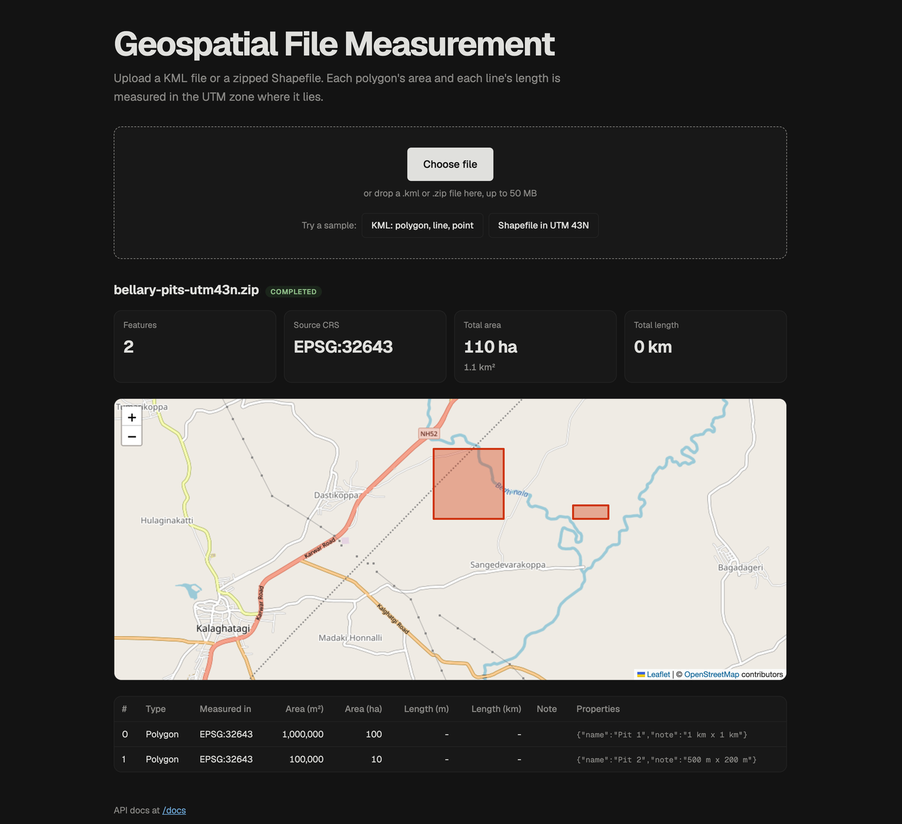
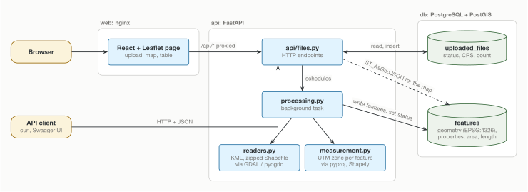

# Geospatial File Measurement API

A FastAPI service that accepts a KML file or a zipped Shapefile, extracts every feature, and reports the area of each polygon and the length of each line in metres. Each feature is measured in the UTM zone where it lies, never in degrees.

A small web page is included for trying it out (not required by the brief; the API is the deliverable). Upload a file or one of two samples, see each feature on a map with totals in ha, km² and km, and click a shape to jump to its row in the measurements table.

**Live demo:** https://geomeasure-web.onrender.com (free hosting: the first request after 15 idle minutes takes about a minute while the server wakes up).



## Setup

You need Docker with Docker Compose.

```bash
git clone https://github.com/Prathu3110/Geospacial_measurement_api.git
cd Geospacial_measurement_api
docker compose up --build
```

| URL | What |
|-----|------|
| http://localhost:5173 | Web page: upload a file, see the map and measurements |
| http://localhost:8000/docs | Interactive API documentation (Swagger UI) |
| http://localhost:8000/health | Health check, includes the PostGIS version |

The API applies database migrations when it starts. Two sample files are in [`frontend/public/samples/`](frontend/public/samples/). The web page can upload them with one click:

- `bengaluru-site.kml`: a polygon, a line with altitude, and a point, in two KML folders, in EPSG:4326.
- `bellary-pits-utm43n.zip`: a Shapefile with two polygons that is already projected (EPSG:32643). The polygons measure exactly 1,000,000 m² and 100,000 m².

### Running the backend without Docker

```bash
docker compose up -d db          # PostGIS only
cd backend
uv sync
uv run alembic upgrade head
uv run uvicorn app.main:app --reload
uv run pytest                    # needs the db container; creates its own geomeasure_test database
```

The frontend runs with `cd frontend && npm install && npm run dev`, and proxies `/api` to port 8000.

## API

| Method | Path | Purpose |
|--------|------|---------|
| `POST` | `/api/files/` | Upload a `.kml` or `.zip` (multipart field `file`, max 50 MB). Returns `202` and a `PENDING` record. |
| `GET` | `/api/files/{id}/` | File information and processing status. |
| `GET` | `/api/files/{id}/measurements/` | Per-feature measurements, paginated with `limit` (1-1000, default 100) and `offset`. |
| `GET` | `/api/files/{id}/features/` | All features as a GeoJSON FeatureCollection in EPSG:4326, for map display. |

### Upload

```bash
curl -F "file=@frontend/public/samples/bengaluru-site.kml" http://localhost:8000/api/files/
```

```json
{
  "id": "ddb54dbd-bcef-49f6-9ca0-f562807115c2",
  "filename": "bengaluru-site.kml",
  "status": "PENDING",
  "crs": null,
  "feature_count": null,
  "error": null,
  "created_at": "2026-10-10T12:08:02.704110"
}
```

Wrong extension: `400`. Larger than 50 MB: `413`. Processing happens after the response is sent, so poll `GET /api/files/{id}/` until `status` is `COMPLETED` (with `crs` and `feature_count` filled in) or `FAILED` (with a reason in `error`, for example `"Shapefile is missing required parts: .prj"`). Unknown id: `404`.

### Measurements

```bash
curl "http://localhost:8000/api/files/ddb54dbd-bcef-49f6-9ca0-f562807115c2/measurements/?limit=100&offset=0"
```

```json
{
  "file_id": "ddb54dbd-bcef-49f6-9ca0-f562807115c2",
  "source_crs": "EPSG:4326",
  "total": 3,
  "limit": 100,
  "offset": 0,
  "items": [
    {
      "feature_index": 0,
      "geometry_type": "Polygon",
      "measurement_crs": "EPSG:32643",
      "area_m2": 1201683.919,
      "area_ha": 120.168,
      "length_m": null,
      "length_km": null,
      "reason": null,
      "properties": {"Name": "Pit A", "layer": "Pits", "owner": "Client X"}
    },
    {
      "feature_index": 2,
      "geometry_type": "Point",
      "measurement_crs": null,
      "area_m2": null,
      "area_ha": null,
      "length_m": null,
      "length_km": null,
      "reason": "no measurement for Point",
      "properties": {"Name": "Marker", "layer": "Roads"}
    }
  ]
}
```

Shortened: the line feature (with `length_m` and `length_km`) and some KML styling properties are left out. A file that is not `COMPLETED` returns `409`.

### Features (GeoJSON)

```bash
curl http://localhost:8000/api/files/ddb54dbd-bcef-49f6-9ca0-f562807115c2/features/
```

Returns a GeoJSON `FeatureCollection` with each feature's geometry, its `feature_index` as `id`, and its measurements in the properties. Geometry is kept out of the measurements response so that response stays small.

## Architecture

Three containers, started together by Docker Compose:



The diagram source is [`docs/architecture.tex`](docs/architecture.tex) (TikZ).

```
backend/
  app/
    main.py              FastAPI app and /health
    db.py                engine and session
    models.py            UploadedFile, Feature (SQLAlchemy + GeoAlchemy2)
    schemas.py           response models (Pydantic)
    api/files.py         the HTTP endpoints
    services/
      readers.py         KML / zipped Shapefile -> GeoDataFrame, with validation
      measurement.py     UTM zone choice, area and length; no database or HTTP code
      processing.py      read -> measure -> store, and sets the status
  alembic/               database migrations
  tests/
frontend/                Vite + React + Leaflet page, served by nginx in Docker
  public/samples/        example KML and Shapefile
docker-compose.yml       db (PostGIS), api, web
```

Routes deal only with HTTP. The services hold the logic. `measurement.py` has no database or HTTP code, so it is tested with plain in-memory geometries.

### File-processing flow

1. `POST /api/files/` checks the extension, streams the upload to a temporary file (stopping at 50 MB), creates an `UploadedFile` row with status `PENDING`, and returns `202`.
2. A FastAPI background task then sets the status to `PROCESSING` and calls `read_features`:
   - **KML** is read with GDAL's LIBKML driver. LIBKML exposes each `<Folder>` as a separate layer, so every layer is read and the layer name is stored as a property. Reading only the first layer would silently drop features.
   - **Zip** archives must contain exactly one `.shp` file plus matching `.shx`, `.dbf` and `.prj` files. The archive is read in place through GDAL's `/vsizip/`, so nothing is extracted to disk. That rules out path-traversal ("zip slip") attacks. The total uncompressed size is checked first to stop zip bombs, and macOS `__MACOSX` entries are ignored.
3. Each feature is measured (see below). Its geometry is stored in EPSG:4326 in a PostGIS `geometry` column, with its properties as JSONB and its measurement values.
4. The file gets `COMPLETED`, along with its CRS and feature count. A bad file gets `FAILED` and a readable error. An unexpected exception is logged and reported as a generic error. The temporary file is always deleted.

### Measurement flow

1. Every feature falls into one of four groups:
   - Polygons and multipolygons are measured for area.
   - Linestrings and multilinestrings are measured for length.
   - Points, multipoints and geometry collections get a `reason` instead of a number.
   - Empty or invalid geometries, such as a self-intersecting "bow-tie" polygon, get a `reason` too. Shapely would return an area for an invalid polygon, but that area is wrong.
2. The UTM zone is chosen from the centre of the feature's bounding box: `zone = floor((lon + 180) / 6) + 1`, using EPSG:326xx north of the equator and 327xx south of it.
3. Features are grouped by zone, and each group is projected in one call, directly from the source CRS. Then Shapely's planar `area` and `length` give square metres and metres. Z values are ignored, so a line's length is its length on the map, not along the slope.

### CRS handling

- The source CRS comes from the file: EPSG:4326 for KML, and the `.prj` for a Shapefile. A Shapefile without `.prj` is rejected. Its coordinates could be degrees, metres or feet in any of thousands of systems, and guessing gives confident but wrong answers.
- Every feature is reprojected to its own UTM zone before measuring, **even when the input is already projected**. Being projected doesn't make a CRS suitable for measuring. Web Mercator (EPSG:3857), for example, makes areas about 4 times too large at 60° latitude. A test covers exactly this case.
- Each measurement records the `measurement_crs` it used, so anyone can reproduce the number in QGIS.
- **Accuracy:** UTM's scale error inside a zone gives at most about 0.2% area error. For a 0.01° square near Bengaluru:

  | Method | Area | Difference |
  |--------|------|------------|
  | WGS84 ellipsoid (geodesic) | 1,200,290 m² | reference |
  | UTM 43N (this service) | 1,201,684 m² | +0.12% |
  | Web Mercator | 1,271,671 m² | +5.9% |

  The tests compare the service's results against `pyproj.Geod` and against PostGIS `ST_Area(geography)`, which are two independent ellipsoidal calculations.

## Design decisions

<!-- TODO(Prathu): rewrite this section in your own words before submitting. -->

- **FastAPI rather than Django REST Framework.** The service has three or four endpoints and no admin or auth needs. FastAPI's typed request handling and generated OpenAPI documentation fit that better than a full Django project.
- **UTM per feature, rather than one CRS per file or geodesic area.** UTM is the standard working CRS in surveying, it satisfies the brief's "transform to a projected CRS", and its error stays below 0.2%. A single CRS per file would break for files that span zones. Geodesic area with `pyproj.Geod` is a valid alternative that is slightly more accurate, so the tests use it as the reference.
- **PostgreSQL with PostGIS rather than SQLite.** Geometries are stored as real spatial types, the map endpoint uses `ST_AsGeoJSON`, and the tests cross-check areas with `ST_Area(geography)`. Docker Compose removes the setup cost.
- **FastAPI BackgroundTasks rather than Celery or RQ.** Uploads return immediately with a status to poll, without adding a broker or worker container. The limit: a restart in the middle of processing leaves that file stuck in `PROCESSING`. A real job queue is the next step if files get large or the API runs on several machines.
- **Reject a missing `.prj` rather than assume EPSG:4326.** A clear failure is better than a plausible wrong number.
- **One bad feature doesn't fail the file.** Unsupported or invalid geometries get `null` plus a `reason`, as the brief asks ("handle it gracefully").
- **Alembic migrations** rather than `create_all`, so the schema can change without losing data. The tests run the real migration.

## Testing

```bash
cd backend && uv run pytest
```

The tests cover the UTM zone formula, areas and lengths against geodesic references, the Web Mercator trap, invalid and unsupported geometries, multi-folder KML, missing `.prj` files, corrupt uploads, and the full API flow against a real PostGIS database. GitHub Actions runs `ruff` and `pytest` on every push, then lints and builds the frontend.

## How I used AI

I built this project with Claude (Anthropic) as a pair programmer and tutor.

- **Design.** Before writing any code, Claude questioned me on each design choice, and we settled them together: PostgreSQL with PostGIS instead of SQLite, measuring each feature in its own UTM zone, rejecting Shapefiles without a `.prj`, background processing, Docker Compose, and a small frontend so reviewers can try it.
- **Learning.** I started with no GIS, FastAPI or pytest experience. Claude wrote short lessons with quizzes alongside the code. They cover features and CRSs, why degrees can't be measured, reading KML and Shapefiles, and pytest.
- **Code.** Claude drafted much of the implementation and the tests. I reviewed every change, ran it, modified parts of it, and made each commit myself.
- **README.** Claude wrote most of this README. I wrote some sections myself and used Claude to format them.
- **Checking.** The numbers aren't taken on trust. The tests compare the results against two independent references, `pyproj.Geod` and PostGIS `ST_Area(geography)`.

I can explain any part of the code and the reasons behind it.

## Learnings

Before this project I had never worked with geospatial files. The biggest lesson was that you can't measure in degrees: a degree of longitude gets shorter the further you are from the equator, so shapes have to be projected into metres (UTM here) before measuring. I also learned how messy real files are. A Shapefile is really four files, KML folders show up as separate layers, and without a `.prj` file you can't trust the numbers at all.

I knew backend concepts but hadn't used FastAPI much. Type hints that give you validation and API docs for free made the endpoints quick to write, and background tasks were a simple way to keep uploads responsive.

PostGIS and the Python geospatial libraries (GeoPandas, Shapely, pyproj, GDAL) were all new to me. Seeing PostGIS calculate the same area on the ellipsoid as my code was a satisfying way to check the maths.

## Future scope

- A job queue (RQ or Celery) with retries, so a server restart can't leave a file stuck in `PROCESSING`.
- More upload formats: KMZ, GeoJSON and GeoPackage. GDAL already reads them, so the work is mostly validation and tests.
- CSV import, with either latitude and longitude columns for points or a WKT geometry column, plus a required CRS column or parameter, since CSV has no `.prj` equivalent.
- Special cases the per-feature UTM choice doesn't cover yet: features that cross the antimeridian, and very large features that span several zones, where geodesic area would suit them better.
